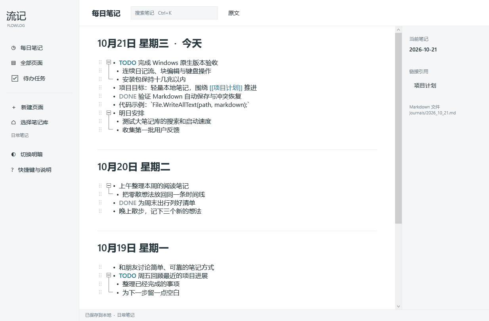

# FlowLog 流记

以连续日记流为中心的轻量 Windows 大纲笔记。**0.2.0 使用 C# / WPF / AvalonEdit 原生实现**，直接编辑本地 Markdown。

[下载 Windows 原生版](https://github.com/iChenwin/flowlog/releases/tag/v0.2.0) · [验证记录](docs/NATIVE-VALIDATION.md) · [架构和兼容边界](docs/NATIVE-ARCHITECTURE.md) · [English](README.en.md)

安装包小于 1 MB，精确字节和 SHA-256 见发布附件 `native-package-report.json`。运行需要系统 **.NET Framework 4.8**，该系统组件不包含在安装包体积内。应用不使用 Electron、WebView、Chromium 或本地网页服务。



## 日常功能

- 今天优先的连续日记流，滚动增量追加更早的日记。
- 每篇笔记是一份完整的原生文本编辑文档，支持跨块选区、复制粘贴和撤销重做；导航后保留光标、选区和历史。
- Enter 拆块、Shift+Enter 块内换行、Tab 缩进、整子树移动与折叠。左侧手柄支持同文档同层块重排。
- TODO / DOING / DONE 任务切换和汇总；全文搜索。
- `[[页面]]` 和 `#标签` 导航、页面补全、反向链接；持久化 `id:: UUID` 和 `((UUID))` 块引用定位。
- `/` 命令补全；源码模式直接编辑复杂 Markdown。显示层不会重新序列化整篇笔记。
- 每次输入同步写入恢复草稿，稍后异步保存 Markdown；冲突保留双方，失败可重试或导出草稿。

这是原生预览版，仍未达到 Logseq 全部本地编辑能力。完整中文输入法候选词交互、长期编辑、大库性能和真实 Logseq 副本迁移需要进一步人工验证；已执行的自动测试不能替代这些验收。

## 安装与开始

1. 下载 `FlowLog-Native-0.2.0-Setup.exe`，或解压便携 ZIP。无需管理员权限。
2. 系统需有 .NET Framework 4.8；安装程序会检查并提示缺失，不会隐藏下载运行时。
3. 选择本地笔记库，或使用“文档”目录中的 `FlowLog`。输入第一条事项，Enter 继续，Tab 缩进。
4. 输入 `[[项目计划]]`，Ctrl+单击链接打开页面；Ctrl+K 搜索，Ctrl+Enter 切换任务。

日记为 `journals/YYYY_MM_DD.md`，页面为 `pages/*.md`。保存前版本在 `.flowlog/backups`（每篇最近20份），冲突双方在 `.flowlog/conflicts`。恢复草稿在当前账户 `%APPDATA%/FlowLogNative/drafts`。卸载保留笔记与草稿。每个 Windows 登录会话只启动一个应用实例，避免多窗口争抢草稿。

支持 `FlowLog.Native.exe --vault "D:\Notes\MyVault"` 指定目录。首次打开已有 Logseq 图谱请用副本。外部修改会在保存时检查，没有实时自动合并；不要同时用多个编辑器写入同库。

## 与 Logseq 的关系

Logseq 桌面使用 Electron，其编辑器以 ClojureScript 实现，见官方 [package.json](https://github.com/logseq/logseq/blob/master/package.json) 和 [editor.cljs](https://github.com/logseq/logseq/blob/master/src/main/frontend/components/editor.cljs)。本项目重现日记流及常用块编辑行为，以 Windows 原生控件重新实现，没有复制其 AGPL 源码。

| 能力 | 0.2 原生版范围 |
| --- | --- |
| 日记流、大纲、任务、页面链接、搜索 | 已实现，实际证据见验证记录 |
| 选区、剪贴板、撤销、块操作 | 原生文档；同层拖块，跨层用缩进快捷键 |
| 属性及未知 Markdown | 保留原文，不提供完整属性语义；部分元数据可在源码模式编辑 |
| 块引用 | UUID 创建、复制引用和跳转；不渲染嵌入内容 |
| 文件兼容 | 读取 journals/pages 顶层 UTF-8 `.md`；日记识别 `YYYY_MM_DD`；新页面名使用 URI 编码 |
| Markdown 排版 | 大纲圆点、标题/任务/链接着色、代码区；不支持完整富文本渲染 |
| 查询、图谱、白板、PDF、插件、同步、数据库图谱、Org mode | 不包含 |

## 快捷键

| 操作 | 快捷键 |
| --- | --- |
| 下一块 / 块内换行 | Enter / Shift+Enter |
| 缩进 / 反缩进 | Tab / Shift+Tab |
| 移动整子树 | Alt+↑ / ↓ |
| 切换任务 | Ctrl+Enter |
| 折叠 / 展开 | Ctrl+. |
| 复制块引用 | Ctrl+Shift+C |
| 搜索 / 重试保存 | Ctrl+K / Ctrl+S |
| 撤销 / 重做 | Ctrl+Z / Ctrl+Y |

## 构建

Windows 系统 .NET Framework 4.x C# 编译器即可，无需 Visual Studio、.NET SDK、Node 或 Rust。脚本下载并校验固定版本 AvalonEdit 与 NSIS 3.13。

```powershell
./scripts/build-native.ps1 -Tests
./scripts/package-native.ps1 -SkipBuild
./scripts/smoke-native.ps1 -Installed
```

输出在 `native/out`，发布包在 `native/packages`。`-Tests` 运行真实 STA WPF 编辑器/窗口与文件测试；安装冒烟通过跨进程 Windows UIAutomation 验证保存、重开、强杀恢复和冲突。安装冒烟使用没有安装本应用的测试账户。CI 为 [Windows native build and release](.github/workflows/windows-native.yml)。

0.1 Tauri/WebView 原型保留在 `src`、`src-tauri`，工作流改为手动，不参与原生版构建。它未满足原生编辑体验要求，旧截图和验证记录不能作为原生版证据。[此前 AI 角色评审](docs/EXPERT-REVIEW.md) 保留用于追溯，不能代替产品验收。

MIT © 2026 iChenwin。AvalonEdit 使用 MIT，随包附许可证。参见[贡献](CONTRIBUTING.md)与[安全](SECURITY.md)。
