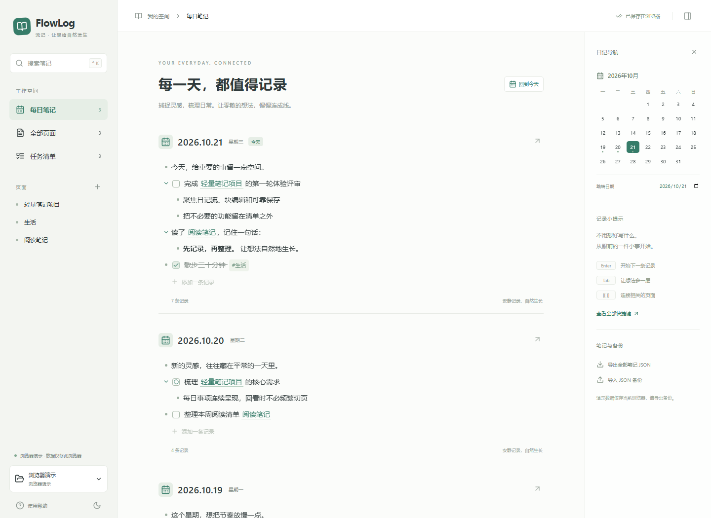

# FlowLog 流记

面向日常事项与随手记录的轻量本地大纲笔记。受 Logseq 的日记流启发，以独立品牌提供一个更小、更集中的桌面实现。

**0.1.0 为预览版。请先备份，并在笔记库副本上试用。** Windows x64 安装包实测 **2,980,260 字节（约 2.98 MB）**，低于 20 MB 上限；校验值见发布附件 `package-report.json`。

[下载 Windows 预览版](https://github.com/iChenwin/flowlog/releases/tag/v0.1.0) · [实际验证记录](docs/VALIDATION.md)

[English](README.en.md) · [AI 专家评审](docs/EXPERT-REVIEW.md) · [发布验收](docs/RELEASE-CHECKLIST.md) · [贡献](CONTRIBUTING.md) · [安全](SECURITY.md)



## 当前功能

- 今天优先的日记流，按需展开更早日期，日历跳转。
- 大纲块编辑、缩进与反缩进、子树移动与折叠、撤销重做。
- TODO / DOING / DONE 任务与任务汇总（仅大纲 Markdown）。
- `[[页面链接]]`、`#标签`、页面建议、反向链接与全文搜索。
- 基础加粗、行内代码及网址显示；复杂 Markdown 提供原文编辑方式。
- 桌面版使用本地 UTF-8 Markdown 文件；自动保存、内容哈希冲突检测、保存前快照和失败草稿提示。
- JSON 备份导出与导入、浅色与深色主题。

这些是当前实现范围，不表示所有平台与人工场景均已验收。浏览器版本仅演示交互，数据存于当前浏览器，不能直接操作磁盘笔记库。

## 安装与一分钟上手

在本仓库 Releases 页面选择 Windows NSIS `.exe` 预发布安装包，并对照 `package-report.json` 校验 SHA-256。若尚无安装包，请按下方步骤从源码构建。

桌面采用 **Tauri 2 + React + TypeScript + Rust**，不用 Electron。依赖系统 **Microsoft Edge WebView2**。安装包可包含运行时引导程序，但不包含完整 WebView2 运行时；系统缺失运行时时可能需要联网下载，额外下载不计入应用安装包大小。有运行时后的离线使用仍应按发布验收记录核实。

1. 打开应用，在今天的日记中写下第一条事项。
2. 按 Enter 继续记录、Tab 缩进；输入 `TODO 今天要做的事`，或按 Ctrl + Enter 切换任务状态。
3. 输入 `[[我的计划]]` 连接页面，用 Ctrl + K 搜索。左下角可选择笔记库文件夹并查看数据位置。

首次默认笔记库存于系统“文档”目录下的 `FlowLog`，以后重启恢复上次所选目录，不要求注册。日记为 `journals/YYYY_MM_DD.md`，页面为 `pages/*.md`；保存前版本位于 `.flowlog/backups`，每篇保留最近 20 份；冲突草稿位于 `.flowlog/conflicts`，不会自动删除。具体恢复方法见 [存储说明](src-tauri/README.md)，请另做独立备份。

## 与 Logseq 的兼容边界

| 内容或能力 | 当前范围 |
| --- | --- |
| Markdown 图谱目录 | 读取所选目录直接下的 `journals`、`pages` 中受支持的 `.md` 文件，不递归扫描 |
| 日记文件名 | `YYYY_MM_DD.md`；其他命名不作为日记读取 |
| 多级 `- ` 大纲、常用任务、页面链接 | 提供基本编辑与导航，语义不等同于完整 Logseq |
| 属性、块 ID、复杂 Markdown | 不提供完整语义；复杂结构以原文方式编辑，未知内容不代表功能已支持 |
| 已编辑大纲的格式 | 可能规范化缩进与换行；不是字节级往返兼容 |
| 块引用、嵌入、命名空间、查询 | 不提供完整支持 |
| 图谱、白板、PDF、插件、云同步、数据库图谱、Org mode | 不支持 |

首次试用请复制原库，再打开副本。应用不提供完整 Logseq 迁移器。磁盘外部修改会在保存时检测；出现冲突先导出草稿，再点击“放弃草稿并重新读取”查看磁盘版本，不要用同一目录进行多个编辑器并行写入。当前外部文件变化不会实时自动合并。退出前确认保存成功。

尚未提供自动更新、发布签名保证或大库性能承诺。未签名安装包可能显示 Windows 信誉提示。中文输入法、干净系统安装、离线首次启动与长期编辑需要独立人工验证，不能由构建成功推定。具体证据见对应版本的发布记录及 CI。

## 快捷键

| 操作 | 快捷键 |
| --- | --- |
| 下一块 / 块内换行 | Enter / Shift + Enter |
| 缩进 / 反缩进 | Tab / Shift + Tab |
| 移动子树 | Alt + ↑ / ↓ |
| 任务状态 | Ctrl + Enter |
| 搜索 | Ctrl + K |
| 撤销 / 重做 | Ctrl + Z / Ctrl + Shift + Z |
| 跨块导航 | 块首 ↑ / 块尾 ↓ |

## 从源码运行

Windows 开发环境需要 Node.js 22、Rust stable、Microsoft C++ Build Tools 和 WebView2。

```sh
npm ci
npm run tauri dev
```

```sh
npm test
npm run build
npm run test:e2e
cargo test --manifest-path src-tauri/Cargo.toml
npx tauri build
```

桌面安装包输出至 `src-tauri/target/release/bundle/nsis/`。执行 `pwsh -File scripts/check-bundle.ps1` 检查实际大小并生成 SHA-256 报告。Windows CI 还进行静默安装、短暂启动和卸载冒烟；它不替代编辑器功能、中文输入法或干净虚拟机验证。`npm run dev` 仅启动浏览器演示。

## 开源与反馈

MIT © 2026 iChenwin。欢迎提交可复现问题与贡献，优先完善本地保存、编辑体验、兼容边界和包体积。请使用匿名样例，勿上传私人笔记。
